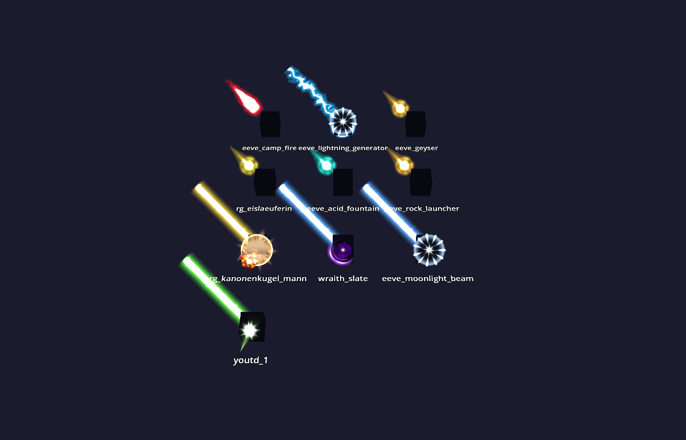
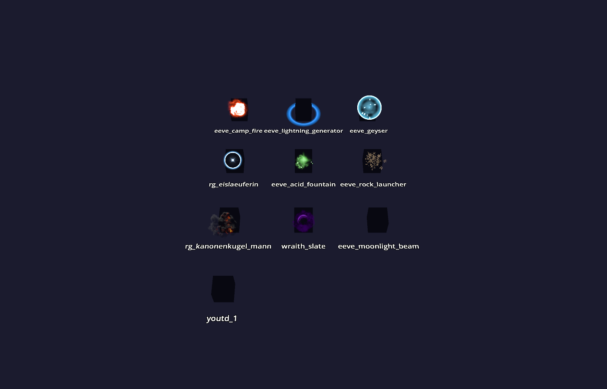

# Art-Pass A1

61 kuratierte Tower erhalten ein explizites Element. Die Freigabeliste liegt in
`data/fx/tower_elements.json`; eeve- und Randgruppen-Generatoren übernehmen sie.
`python tools/art/element_vorschlag.py` zeigt weitere Namenshinweise an;
`--anwenden` schreibt ausschließlich freigegebene Zuordnungen. Aktuell gibt es keine
weiteren eindeutigen Namensvorschläge. Mehrdeutige Tower bleiben unverändert.

Wahl: eigene Effekt-/Soundangabe, Element, Fähigkeit, Farbe. YouTD überträgt seine
sieben Elemente und das Blitzflag; Maul behält die bisherige Farbwahl.
Schüsse bleiben in Towerfarbe. Automatische Elementtreffer behalten ihre eigene
Farbe, damit etwa die orange Eisläuferin einen blauen Frostring erzeugt.
Bestehende eigene Treffer-Overrides bleiben einschließlich ihrer Färbung erhalten.

## Belege

Alle zehn Elemente in derselben Reihenfolge: Feuer, Blitz, Wasser, Eis, Gift,
Erde, Physisch, Dunkel, Licht (bestehender eigener Treffer), Natur (YouTD).
Aufgenommen stumm und ohne Fokus auf Bildschirm 2. Zusatzlicht ist für die
Vergleichsgalerie abgeschaltet, um Partikel und Farben sichtbar zu halten.

## Prüfung

- `fxelement`: 0 Fehler, einschließlich aller YouTD-Elementzuordnungen.
- `sound`: 38 Prüfungen bestanden.
- `vor_pr.sh --ohne-merge`, Basis `ec1462e`: sämtliche ausgewählten Spieltests
  bestanden, einschließlich GemTD/eeve/Randgruppen-Tower und YouTD.
- Gesamtstatus dennoch **NICHT BEREIT**: bereits in `ec1462e` vorhandener
  Übersetzungsbefund `scripts/heroes/hd_skill_card.gd:236`,
  `[color=#%s]%s%s[/color]`. Keine A1-Oberfläche betroffen.
- Tower-Tabelle neu erzeugt, inhaltlich unverändert. `git diff --check` sauber.

A2 wird separat auf diesem Stand aufgebaut. A3/A4 sind hier nicht enthalten.
