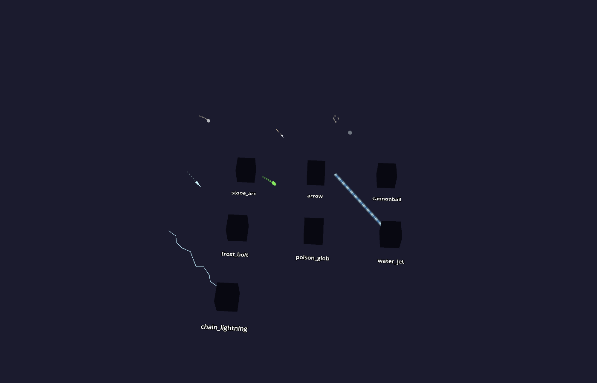
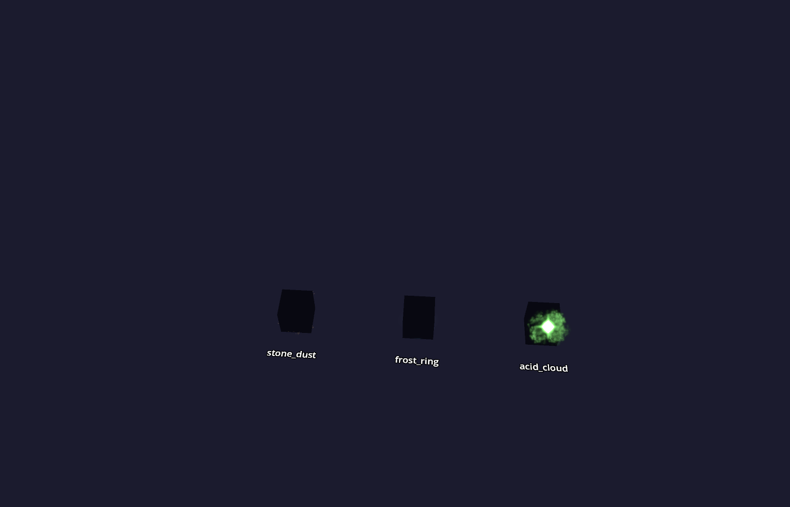
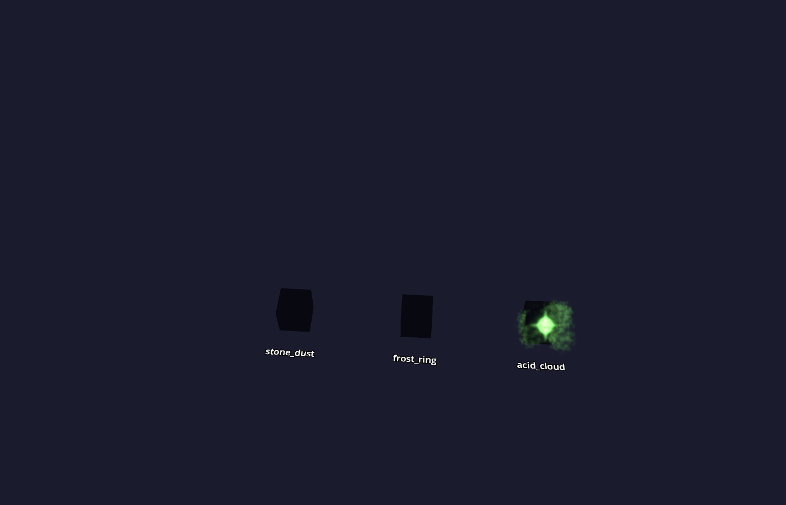
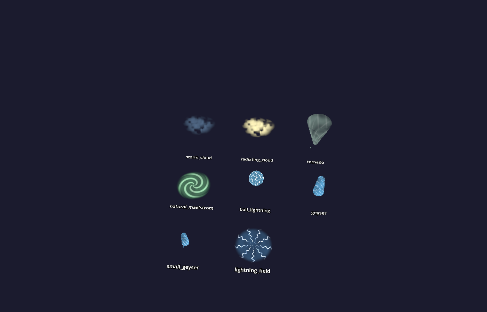
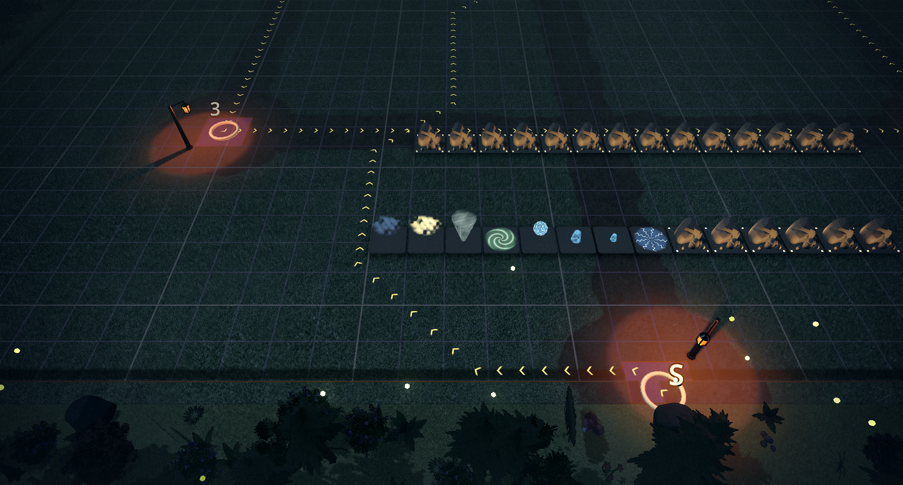

# Art-Pass A2

Aufbau auf A1 ([PR #147](https://github.com/Tulkor/TDHub/pull/147)), eigener
Branch `codex/art-pass-a2`. Keine Downloads oder neuen Fremdassets.

## Umsetzung

- Sieben prozedurale Geschosse: ballistischer grauer Stein mit Staubspur,
  ausgerichteter Pfeil mit Spitze, dunkle Kanonenkugel mit flachem Bogen und
  Mündungsrauch, Frostsplitter mit Flocken, transparenter Gifttropfen mit Spur,
  Wasserstrahl mit fließenden UVs, zusammenhängender gezackter Kettenblitz.
- Elementzuordnung aktualisiert. Kanonenkugel-Mann erhält die Kanonenvariante;
  Hydro-/Tsunamikanone den Wasserstrahl. Neue Geometrie behält ihre Materialfarbe
  (grauer Stein, dunkle Kugel, blauer Frost); bestehende Sprite-Schüsse behalten
  die Towerfärbung.
- `stone_dust`, `frost_ring`, `acid_cloud`: Bodenstaub, liegender Frostring und
  1,3 Sekunden Giftwolke. Höchstens 24 Partikel, auf Niedrig 12; keine Zusatzlichter.
- Acht dauerhafte eeve-Effekttower: Sturm-/Strahlende Wolke mit Noise-Billboards,
  Tornado mit laufender Textur und Trümmern, spiralförmiger Mahlstrom, Kugelblitz,
  Geysir/Kleiner Geysir und Blitzfeld. Shaderanimation, auch Fallenpfad, kein
  Ersatzkristall und keine zusätzlichen Lichter. Vier statt acht Partikel auf
  Niedrig, auch nach einem Grafikwechsel während des Spiels.
- Geometriegrößen relativ zu `Board3D.CELL`. Geschosse nutzen gemeinsame
  MultiMesh-Batches statt Knoten je Schuss. Abgelaufene Batches werden unsichtbar.
- `tools/fx/prozedurale_effekte.py` registriert die Effekte reproduzierbar;
  der Kenney-Generator ruft es automatisch auf. Modellgeneratoren erhalten
  `effect_tower` aus `tower_models.json`.

## Bilder

Stumm, fokuslos auf Bildschirm 2 gerendert. Die Galerien zeigen die Materialien
ohne Zusatzlicht. `--vitrine-direkt` setzt in der Spielvorschau die exakten Tower,
weil die reguläre Vitrine bei gesperrten Bauketten frühere Tower anzeigen kann.

## Leistung

RX 9070 XT, Godot 4.3 Forward+, Hoch, VSync aus, jeweils acht Sekunden über
`render_windows.ps1`. Gleiche Optionen auf A1 (`5ac6475`) und A2:
`--map=<modus> --phase=welle --treffer --messen=8 --grafik=2`.
Vollständige Mittel-/p95-/Max-Werte: [Messdaten](art-a2-messung.json).

| Karte | A1 Bildzeit | A2 Bildzeit | Differenz |
|---|---:|---:|---:|
| eeve | 13,01 ms | 12,52 ms | −0,49 ms |
| YouTD | 13,20 ms | 12,73 ms | −0,47 ms |
| Randgruppen | 19,47 ms | 14,61 ms | −4,86 ms |

In diesen Läufen keine Zunahme um mehr als 0,3 ms. **Kein Nachweis einer
Beschleunigung:** nur ein Lauf pro Stand, nicht kontrollierte Fremdlast; am Ende
jeweils keine lebenden Gegner, kein Dauerlast-Benchmark der neuen Effekte.
[PR #145](https://github.com/Tulkor/TDHub/pull/145) nennt eeve 9,3 ms und einen durch
Fremdlast verfälschten Kontrolllauf. Dessen Szene/Last ist hier nicht identisch;
das Ziel von maximal +0,3 ms gegenüber diesem Wert ist nicht belastbar bestätigt.

## Prüfung und Übergabe

`fxprocedural` und `fxelement`: jeweils 0 Fehler; GPU-Test ebenfalls 0 Fehler,
keine Shaderfehler. Geprüft sind Bogen-Endpunkte und Höhe, Pfeilrichtung,
lückenlose Blitzsegmente, Partikelbudgets, Ausblenden nach Ablauf, alle acht
Tower-Mappings, beide Grafikstufen und Wechsel zur Laufzeit.

`vor_pr.sh --ohne-merge`, Basis A1: Sound, YouTD, Bezirk, eeve-Items, eeve,
Fähigkeiten, gemischte Elemente, Randgruppen und alle vier Tower-Prüfungen
bestanden (GemTD 94, eeve 111, Maul 220, Randgruppen 92).
Gesamtcheck weiterhin **NICHT BEREIT** wegen des bereits auf Claudes Basis
vorhandenen Übersetzungsbefunds `hd_skill_card.gd:236`; keine neue UI betroffen.
Tower-Tabelle erzeugt, inhaltlich unverändert. Generatorprüfung und Python-Syntax
bestanden. Keine Merge-Freigabe.

Offen für Claude: bestehender Übersetzungsbefund und ein kontrollierter
Dauerlastvergleich gegen die identische Szene aus PR #145. A3/A4 bleiben außerhalb
dieses PRs und benötigen die vereinbarte Download-Freigabe.
